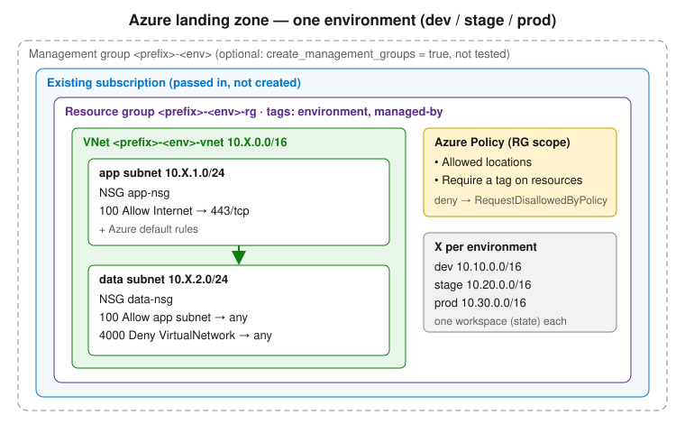

# terraform-azure-landing-zone

A small, reusable Terraform module that lays down the base of an Azure environment:
resource group, VNet, subnets, NSGs and Azure Policy assignments, with the same code
for **dev**, **stage** and **prod**.

## Problem it solves

> Create a Terraform module that provisions an enterprise Azure landing zone with Management
> Groups, subscriptions, resource groups, VNets, subnets, NSGs, and Azure Policy assignments.
> Support dev, stage, and production environments through parameterized configurations.

Every new environment needs the same foundation: a place for its resources, a network split
into tiers, traffic rules between those tiers, and guardrails that stop resources from being
created in the wrong region or without ownership tags. Building that by hand per environment
drifts quickly. This module builds it from one set of inputs.

## Architecture



| Piece | Name | Details |
|---|---|---|
| Management group | `<prefix>-<env>` | Optional (`create_management_groups = true`). Moves the subscription into it |
| Subscription | — | Existing one, passed in (not created) |
| Resource group | `<prefix>-<env>-rg` | Every resource gets `environment=<env>` and `managed-by=terraform` |
| VNet | `<prefix>-<env>-vnet` | One `/16` per environment |
| Subnets | `<prefix>-<env>-app-snet`, `-data-snet` | `x.x.1.0/24` and `x.x.2.0/24`, carved with `cidrsubnet` |
| NSGs | `<prefix>-<env>-app-nsg`, `-data-nsg` | One per subnet (rules below) |
| Policy | `Allowed locations`, `Require a tag on resources` | Built-in definitions, assigned at **resource group** scope |

NSG rules:

| NSG | Priority | Rule |
|---|---|---|
| app | 100 | Allow TCP 443 from `Internet` |
| data | 100 | Allow any from the app subnet |
| data | 4000 | Deny any from `VirtualNetwork` (closes Azure's default rule 65000, which allows all VNet traffic) |

### Design decisions

- **Subscriptions are an input, not a resource.** Creating subscriptions needs an EA/MCA billing
  account. In practice a landing zone receives subscriptions that already exist (subscription
  vending is a separate process).
- **Policies are assigned to the resource group, not the subscription,** so the module is safe to
  run in a shared subscription without affecting other teams.
- **Management groups are off by default** because they need tenant-level permissions.
- **Built-in policy definitions** are looked up by display name, so no definition IDs are hardcoded.
- **One Terraform workspace per environment.** All three tfvars files use the same code but
  different state, so applying prod never touches dev.

See [docs/BUILD_GUIDE.md](docs/BUILD_GUIDE.md) for the build order and the reasoning behind it.

## Repository layout

```
.
├── main.tf, variables.tf, outputs.tf, versions.tf   # root configuration (calls the module)
├── modules/landing-zone/                            # the reusable module
├── envs/{dev,stage,prod}.tfvars                     # per-environment values
├── tests/plan.tftest.hcl                            # terraform test, mocked provider
├── e2e/azure/run.sh                                 # end-to-end test in a real subscription
├── docs/                                            # architecture diagram + build guide
└── .github/workflows/ci.yml                         # fmt, validate, test, shellcheck
```

## Usage

### Deploying an environment

```bash
az login
export ARM_SUBSCRIPTION_ID=$(az account show --query id -o tsv)
terraform init
terraform workspace select -or-create dev
terraform plan  -var-file=envs/dev.tfvars
terraform apply -var-file=envs/dev.tfvars
```

Repeat with `stage` / `prod` (workspace and tfvars file). To remove an environment:

```bash
terraform workspace select dev
terraform destroy -var-file=envs/dev.tfvars
```

### Using the module from another configuration

```hcl
module "landing_zone" {
  source = "github.com/johnvega-cloud/terraform-azure-landing-zone//modules/landing-zone"

  prefix            = "azlz"
  environment       = "stage"
  location          = "eastus"
  address_space     = "10.20.0.0/16"
  allowed_locations = ["eastus"]
}

# Consumers use the outputs, e.g. a VM or AKS node pool in the app subnet:
#   subnet_id = module.landing_zone.subnet_ids["app"]
```

## Inputs

| Name | Type | Default | Description |
|---|---|---|---|
| `prefix` | string | — | 2–10 lowercase letters/digits |
| `environment` | string | — | `dev`, `stage` or `prod` (validated) |
| `location` | string | — | Azure region |
| `address_space` | string | — | VNet CIDR (validated) |
| `allowed_locations` | list(string) | — | Regions allowed by policy |
| `required_tag_name` | string | `environment` | Tag every resource must carry |
| `tags` | map(string) | `{}` | Extra tags |
| `create_management_groups` | bool | `false` | Create a management group and move the subscription |
| `subscription_id` | string | `null` | Required only when `create_management_groups = true` (validated) |

## Outputs

| Name | Description |
|---|---|
| `resource_group_name` | Name of the resource group |
| `vnet_id` | VNet ID |
| `subnet_ids` | Map `app` / `data` → subnet ID |
| `subnet_prefixes` | Map `app` / `data` → CIDR |
| `nsg_ids` | Map `app` / `data` → NSG ID |
| `policy_assignment_ids` | IDs of the two policy assignments |
| `management_group_id` | Management group ID, or `null` when disabled (module output only) |

## Naming convention

`<prefix>-<env>-<role>-<type>`: `azlz-dev-rg`, `azlz-dev-vnet`, `azlz-dev-app-snet`,
`azlz-dev-data-nsg`, `azlz-dev-allowed-locations`. The type suffixes follow the Cloud Adoption
Framework abbreviations (`rg`, `vnet`, `snet`, `nsg`).

## Security notes

- No subscription IDs or secrets are committed. The provider reads `ARM_SUBSCRIPTION_ID` or the az login.
- The data subnet only accepts traffic from the app subnet, including inside the VNet.
- The policies use their built-in default effect, `Deny`: a non-compliant resource is never created.
- The module's own resources always carry the required tag, so it passes its own policy.
- Least privilege to run it: Contributor + Resource Policy Contributor on the subscription
  (Owner also works). Management groups need Management Group Contributor at the tenant root.

## Idempotency and safe changes

- Re-running `apply` with the same inputs makes no changes (checked by the e2e test).
- Changing `address_space` or `prefix` replaces the network: plan first and read it.
- Each environment has its own workspace (state), so a change to one never plans against another.
- Policy assignments can take a few minutes to become effective after the first apply.
- State is local in this lab. In a team setup, use a remote backend (Azure Storage with state locking).

## Cost

Everything this module creates is free: resource groups, VNets, subnets, NSGs and Azure Policy
assignments on Azure resources have no charge. Costs start with what you deploy into the
subnets. Check the Azure pricing pages for the services you add.

## Testing and CI

`terraform test` runs 4 tests against a **mocked** azurerm provider (no login, nothing created):

- dev: resource group name, subnet ranges, 2 subnets, 2 policy assignments, no management group
- prod: name and ranges come from the prod values
- an unknown environment (`qa`) is rejected
- `create_management_groups = true` without `subscription_id` is rejected

CI (`.github/workflows/ci.yml`) runs `terraform fmt -check`, `validate`, `test`, and
`shellcheck` on the e2e script.

### End-to-end test in real Azure

```bash
az login
e2e/azure/run.sh
```

It deploys the dev values with its own prefix (`azlze2e`) in a separate workspace, then checks
15 things: the resources and their rules with `az`, that a second plan is empty, that an NSG
without the required tag and an NSG in `westus` are both rejected with `RequestDisallowedByPolicy`,
that a compliant NSG is accepted, and that `destroy` removes the resource group. The destroy always
runs, even if a check fails. Takes about 6 minutes.

Last run: 15 passed, 0 failed.

## Known limits

- **Management groups are untested.** The code is there, but the test account has no
  tenant-level permissions.
- **stage and prod were only planned**, not applied. They use the same code as dev with
  different values.
- Subscriptions are not created (needs a billing account).
- Two subnets and two built-in policies are a starting point. Hub-and-spoke networking, Azure
  Firewall and custom policy initiatives are outside this module.

## Requirements

- Terraform >= 1.9 (tested with 1.14.7)
- azurerm provider ~> 4.0
- Azure CLI (for login and the e2e test)

## Author

John Vega

## License

MIT, see [LICENSE](LICENSE).
